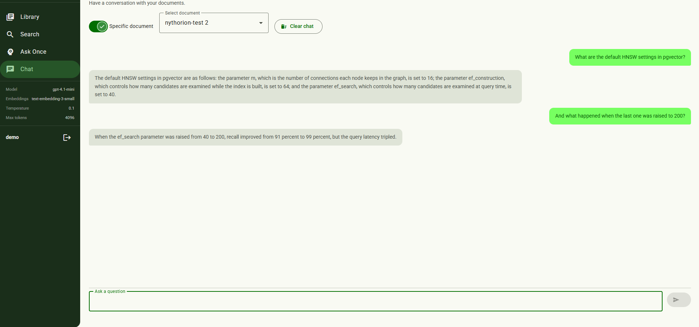

# Nythorion on Azure

A proof of concept that deploys **Nythorion**, an AI knowledge and learning platform, to Azure. You upload PDF and DOCX files, then search them semantically, chat with them (RAG), and generate summaries, flashcards and quizzes.

The application started as a local project that ran on Ollama. This fork replaces Ollama with **Azure OpenAI** and adds the infrastructure and pipeline needed to run it on a free trial subscription:

- **Infrastructure as code** with Bicep, deployed and torn down by script
- **Azure Container Apps** for the API and the auth server, **Static Web Apps** for the Angular app
- **PostgreSQL Flexible Server** with the pgvector extension for documents and embeddings
- **Azure OpenAI** reached through a managed identity, with no API keys anywhere
- **GitHub Actions** that test, build images to GHCR and deploy to Azure through OIDC

> Built for hands-on learning. The environment was deployed, tested and then deleted to stay within the trial credit, so there is no live URL.



---

## Architecture


| Resource | Purpose | Notes |
|---|---|---|
| Container Apps environment + Log Analytics | Hosts both apps, collects logs | Log ingestion capped at 0.1 GB/day |
| `ca-nyth-api` | .NET API: documents, search, chat, flashcards, quizzes | 0.5 CPU, 1 GiB, exactly one replica |
| `ca-nyth-auth` | OpenIddict auth server | 0.25 CPU, 0.5 GiB, one replica |
| Static Web App | Angular frontend | Free tier |
| PostgreSQL Flexible Server | Databases `nythorion` and `nythorion_auth` | Burstable B1ms, 32 GB, pgvector enabled |
| Azure OpenAI | Chat and embeddings | `GlobalStandard` deployments, local auth disabled |

The application code is a modular monolith with vertical slices and MediatR. The AI calls go through `Microsoft.Extensions.AI` (`IChatClient` and `IEmbeddingGenerator`), so the application does not depend on a specific provider.

### Design decisions

- **No secrets in the application.** The API calls Azure OpenAI as itself. Its system-assigned identity holds the `Cognitive Services OpenAI User` role, and the SDK gets tokens through `DefaultAzureCredential`. Local API key authentication on the OpenAI account is disabled.
- **One API replica on purpose.** The document processing queue lives in memory, so scaling out would split the work and lose jobs.
- **Explicit token issuer.** The auth server sets its issuer from configuration, because behind the Container Apps ingress it cannot reliably derive its own public URL.
- **Everything in one resource group.** One command deletes it all, which is how the trial credit is protected.

---

## Deploying

Needs the Azure CLI (logged in), Bicep, and two container images built by the pipeline.

```powershell
./infra/up.ps1 -ApiImage ghcr.io/<owner>/nythorion-api:<sha> -AuthImage ghcr.io/<owner>/nythorion-auth:<sha>
```

The script creates the resource group, generates the database and seed-user passwords into a git-ignored file (`infra/.secrets.local.json`), and deploys `infra/main.bicep`. `-WhatIf` previews the changes.

Afterwards the Angular app is deployed by the `deploy-web.yml` workflow, which reads the deployed API and auth addresses from Azure. It can be started manually from the Actions tab.

To remove everything, including the soft-deleted Azure OpenAI account so its name and quota can be reused:

```powershell
./infra/down.ps1
```

---

## Pipeline

| Workflow | Trigger | What it does |
|---|---|---|
| `build-images.yml` | push to `main` | Runs all tests, then builds the API and auth images and pushes them to GHCR tagged with the commit SHA |
| `deploy.yml` | build succeeded | Logs in to Azure with OIDC, updates the API container app to the new image, and polls `/health` until it answers. It also updates the auth container app when `src/Nythorion.Auth` changed, because restarting that server signs everyone out (this step was written but never exercised, since no commit touched the auth server after it was added) |
| `deploy-web.yml` | push touching `src/Nythorion.Web` | Builds the Angular app, reads the API and auth addresses from Azure into `config.json`, fetches the Static Web App deployment token at run time, uploads the build, and checks that the site serves the new config |

Only the infrastructure itself is not in the pipeline. The Bicep template is applied by hand, as it normally is.

The deploy identity is an Entra app registration with a **federated credential** that trusts only this repository's `main` branch, and the **Contributor** role on the single resource group. No client secret exists. All third-party actions are pinned to commit SHAs.

The pipeline was proven with a real change: a prompt fix for flashcards was committed, built and deployed, and the live logs showed the new model behaviour a few minutes later.

---

## What was verified on Azure

Checked by hand against the deployed environment, with test documents and a 50-page architecture book:

- Login through the authorization code flow with PKCE
- Upload and processing: parsing, chunking and embedding into pgvector
- Semantic search that returns the right chapter for queries that share few words with the text
- RAG chat: grounded answers, follow-up questions that depend on history, a comparison across two chapters, and refusals for questions the document does not cover
- Summary (map-reduce over all chunks), flashcards and quizzes with `gpt-4.1-mini`

The test document contains invented statistics, so an answer that quotes them can only have come from the document and not from the model's training data.


The automated tests (75 across unit and integration projects) use fakes for the AI services, so they run without Azure.

---

## Known limitations

- Auth signing keys and ASP.NET Data Protection keys are created at startup, so restarting the auth server signs everyone out.
- The processing queue is in memory, so a restart drops documents that were still being processed.
- A question that compares two topics can have its retrieval crowded out by one of them. Chat retrieves 8 chunks, which usually covers both, but it is not guaranteed.
- Chunking ignores document structure, so a chunk can span a chapter boundary, and PDF text keeps hyphenation and page footers.
- Two simultaneous "generate flashcard" requests can create the same card, because the duplicate check reads existing questions once per request.
- Quizzes reuse flashcard answers as the wrong options, so the distractors are easy to rule out.
- Registration is closed and a single seeded demo account exists. There is no production hardening beyond that.

## Cost

While running, the environment was estimated at roughly $1 to $2 per day, mostly the always-on Container Apps replicas and the Postgres server. The embedding calls for a 50-page book cost a fraction of a cent. The deployment was removed after testing.

---

## Local development

Run the three services against a local Postgres with pgvector:

```bash
docker compose -f docker/docker-compose.yml up -d
dotnet tool restore
dotnet ef database update --project src/Nythorion.Api
dotnet ef database update --project src/Nythorion.Auth
```

Copy each `appsettings.Development.json.example` to `appsettings.Development.json` and fill in the values. The API example points at an Azure OpenAI endpoint, and your own identity needs the `Cognitive Services OpenAI User` role on it. The Bicep parameter `developerPrincipalId` grants that role at deploy time.

```bash
dotnet run --project src/Nythorion.Auth --launch-profile https
dotnet run --project src/Nythorion.Api --launch-profile https
cd src/Nythorion.Web && npm install && npm start
```

Tests:

```bash
dotnet test
```

Integration tests start a PostgreSQL container with Testcontainers, so Docker must be running.

> Built as an exploration project with the assistance of [Claude](https://claude.ai).
