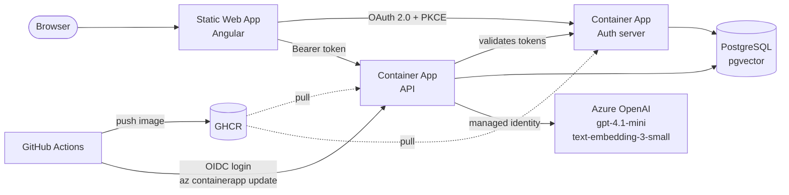
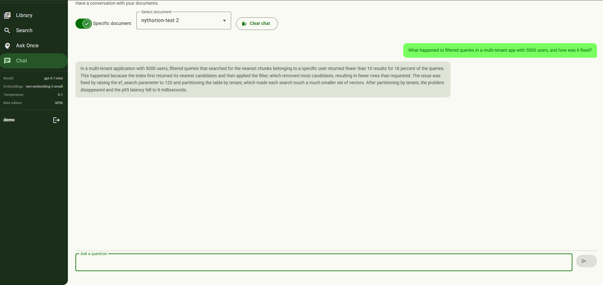

# Nythorion on Azure

A proof of concept that deploys **Nythorion**, an AI knowledge and learning platform, to Azure. You upload PDF and DOCX files, then search them semantically, chat with them (RAG), and generate summaries, flashcards and quizzes.

The application started as a local project that ran on Ollama. This fork replaces Ollama with **Azure OpenAI** and adds the infrastructure and pipeline needed to run it on a free trial subscription:

- **Infrastructure as code** with Bicep
- **Azure Container Apps** for the API and the auth server, **Static Web Apps** for the Angular app
- **PostgreSQL Flexible Server** with the pgvector extension for documents and embeddings
- **Azure OpenAI** reached through a managed identity, so there is no OpenAI key anywhere
- **GitHub Actions** that test, build images to GHCR and deploy to Azure through OIDC

> Built for hands-on learning. The environment was deployed, tested and then deleted to stay within the trial credit, so there is no live URL. The Azure resources, the deploy identity and the GitHub secrets are gone, so the deploy workflows stop at the Azure login until the steps under [Deploying](#deploying) are repeated. The build and test workflow still runs.


---

## Architecture



| Resource | Purpose | Notes |
|---|---|---|
| Container Apps environment + Log Analytics | Hosts both apps, collects logs | Log ingestion capped at 0.1 GB/day |
| `ca-nyth-api` | .NET API: documents, search, chat, flashcards, quizzes | 0.5 CPU, 1 GiB, exactly one replica |
| `ca-nyth-auth` | OpenIddict auth server | 0.25 CPU, 0.5 GiB, one replica |
| Static Web App | Angular frontend | Free tier |
| PostgreSQL Flexible Server | Databases `nythorion` and `nythorion_auth` | Burstable B1ms, 32 GB, pgvector enabled |
| Azure OpenAI | Chat and embeddings | `GlobalStandard` deployments, local key auth disabled |

The application code is a modular monolith with vertical slices and MediatR. The AI calls go through `Microsoft.Extensions.AI` (`IChatClient` and `IEmbeddingGenerator`), so the application does not depend on a specific provider.

### Design decisions

- **No OpenAI key.** The API calls Azure OpenAI as itself. Its system-assigned identity holds the `Cognitive Services OpenAI User` role, and the SDK gets tokens through `DefaultAzureCredential`. Key authentication on the OpenAI account is disabled. The database and demo-user passwords still exist, as Container Apps secrets (see the limitations).
- **One API replica on purpose.** The document processing queue lives in memory, so scaling out would split the work and lose jobs.
- **Explicit token issuer.** The auth server sets its issuer from configuration, because behind the Container Apps ingress it cannot reliably derive its own public URL.
- **Everything in one resource group.** One command deletes it all, which is how the trial credit is protected.
- **Deploy on every push that changes the code, without an approval gate.** Pushes that touch only `src/`, `tests/` or the build workflow build images, and only a successful build deploys. Fine for a single-person proof of concept. For anything real, put an approval step in front of the deploy.

---

## Deploying

### Before you start

- **Tools:** the Azure CLI (logged in, with its Bicep component), PowerShell 5.1 or newer, and a GitHub account with Actions enabled. The .NET SDK, Node and Docker are only needed for local development.
- **Subscription:** it needs room for a Postgres Burstable B1ms, Container Apps, and two Azure OpenAI deployments (`gpt-4.1-mini` and `text-embedding-3-small`, both `GlobalStandard`). Check availability in your regions first:

  ```bash
  az cognitiveservices model list --location <region> --output table
  az cognitiveservices usage list --location <region> --output table    # your quota
  az postgres flexible-server list-skus --location <region>
  ```

- **Resource providers:** on the trial used here, `Microsoft.App`, `Microsoft.CognitiveServices` and `Microsoft.DBforPostgreSQL` were registered by hand (`az provider register --namespace <name>`). Check them on a fresh subscription.
- **Regions are trial-specific.** The defaults are what worked on one trial subscription, where West Europe, East US and Germany West Central were restricted: the resource group, OpenAI and Container Apps in `swedencentral` (`up.ps1 -Location`), Postgres in `denmarkeast`, and the Static Web App in `centralus`. Override them with `-Location`, `-PostgresLocation` and `-StaticWebAppLocation` on `up.ps1`. `down.ps1` has its own `-Location` (default `swedencentral`), which must match the group's region so the OpenAI purge finds the account.

### First deployment, in order

1. **Get the images built.** Push this repository to your own GitHub account. The `Build images` workflow runs the tests and pushes `nythorion-api` and `nythorion-auth` to `ghcr.io/<owner>/`, tagged with the commit SHA. The deploy workflows fail on this first run because Azure does not exist yet. That is expected.
2. **Make both packages public.** GitHub → your profile → Packages → each package → Package settings → Change visibility → Public. New packages are private, and Container Apps pulls without credentials, so a private package makes the deployment fail on the image pull. The images contain no secrets.
3. **Deploy the infrastructure** with the full 40-character commit SHA from step 1 (`git rev-parse HEAD`, also shown on the build run):

   ```powershell
   ./infra/up.ps1 -ApiImage ghcr.io/<owner>/nythorion-api:<sha> -AuthImage ghcr.io/<owner>/nythorion-auth:<sha>
   ```

   The script creates the resource group, generates the database and demo-user passwords into the git-ignored `infra/.secrets.local.json`, and deploys `infra/main.bicep`. `-WhatIf` previews the changes, but it still creates the empty resource group first, because what-if needs it to exist. Add `-DeveloperPrincipalId $(az ad signed-in-user show --query id -o tsv)` to let your own login call Azure OpenAI for local development. The deployment outputs include the API, auth and web addresses. The script reuses the secrets file on later runs: if you delete it while the database still exists, the password cannot be recovered, so reset it in the portal or delete the group and start again.

   > **Status:** on the trial used here the CLI repeatedly failed on this request with a connection reset (`ConnectionResetError 10054`), so the template was deployed through the portal and `up.ps1` was never run through to the end. The template is the same either way. To use the portal: `az bicep build --file infra/main.bicep --outfile main.json`, then portal.azure.com → Deploy a custom template → Build your own template in the editor → Load file → choose the resource group, and fill in the parameters listed at the top of `infra/main.bicep`. Any random 24-character alphanumeric strings work as passwords.
4. **Create the GitHub to Azure trust** (below), then store its three IDs as repository secrets.
5. **Publish the frontend** by running the `Deploy web to Azure` workflow from the Actions tab. Also run `Deploy to Azure` manually with the commit SHA, because its automatic run in step 1 failed. After this, every push that changes the code deploys by itself.

### The GitHub to Azure trust

The pipeline logs in with OIDC, which needs an app registration, a federated credential, and a role on the resource group. The role disappears with the group, so after a teardown it has to be created again.

```bash
az ad app create --display-name nythorion-github-deploy --query appId -o tsv
az ad sp create --id <appId>
az ad sp show --id <appId> --query id -o tsv          # the service principal object ID
az ad app federated-credential create --id <appId> --parameters credential.json
az role assignment create --assignee-object-id <servicePrincipalObjectId> --assignee-principal-type ServicePrincipal \
  --role Contributor --scope /subscriptions/<subscriptionId>/resourceGroups/rg-nythorion
```

`credential.json`:

```json
{
  "name": "github-main",
  "issuer": "https://token.actions.githubusercontent.com",
  "subject": "<see below>",
  "audiences": ["api://AzureADTokenExchange"]
}
```

GitHub now puts numeric owner and repository IDs in the subject, so the plain form `repo:<owner>/<repo>:ref:refs/heads/main` fails with `AADSTS700213`. Build the correct subject with:

```bash
gh api repos/<owner>/<repo> --jq '"repo:\(.owner.login)@\(.owner.id)/\(.name)@\(.id):ref:refs/heads/main"'
```

The login error message also prints the exact subject it received. Then store the app's client ID, the tenant ID and the subscription ID (`az account show --query "{tenant:tenantId, subscription:id}"`) as the repository secrets `AZURE_CLIENT_ID`, `AZURE_TENANT_ID` and `AZURE_SUBSCRIPTION_ID`. They are identifiers and not credentials, and no client secret exists.

### Tearing down

```powershell
./infra/down.ps1
```

This deletes the resource group, purges the soft-deleted Azure OpenAI account so its name and quota can be reused, and removes the local secrets file. The Entra app registration and the GitHub secrets are separate and stay until you delete them:

```bash
az ad app delete --id $(az ad app list --display-name nythorion-github-deploy --query "[0].appId" -o tsv)
gh secret delete AZURE_CLIENT_ID --repo <owner>/<repo>
gh secret delete AZURE_TENANT_ID --repo <owner>/<repo>
gh secret delete AZURE_SUBSCRIPTION_ID --repo <owner>/<repo>
```

Until the secrets are removed, every push to `main` makes the deploy workflows fail at the Azure login. To confirm that nothing is left, `az group list` should show no `rg-nythorion`, and `az ad app list --display-name nythorion-github-deploy` should return an empty list.

### Coming back later

Before rebuilding after months, check what has moved:

- **Models.** The model names and versions are pinned in `infra/modules/openai.bicep`, and the deployment names the app uses are in `appsettings.json` under `AzureOpenAI`. Models get retired: `gpt-4o-mini` was already deprecated during this project. Check `az cognitiveservices model list`, and if you change a deployment name, change both places.
- **Regions, quota and prices.** Run the availability checks above again.
- **Images.** The GHCR packages were deleted after the teardown, and the `Build images` workflow is disabled in this repository so that a push cannot recreate them. To rebuild: `gh workflow enable "Build images"`, then run it from the Actions tab or push a change. A recreated package starts private, so make it public again (see step 2 above).
- **.NET and Node.** To my knowledge .NET 9 leaves support in November 2026, so consider moving the projects and Dockerfiles to a newer version.
- **Pinned versions.** The GitHub Actions are pinned to commit SHAs and the Bicep resources to API versions. Both age, so refresh them.
- **The OIDC subject format** has changed once already. Use the `gh api` command above instead of typing it from memory.
- **Resource names are hard-coded** in the workflows (`rg-nythorion`, `ca-nyth-api`, `ca-nyth-auth`), and the resource group is also the default of `up.ps1` and `down.ps1`. If you change `namePrefix` or the resource group, change all of them.
- **The pipeline changes images outside the template.** Re-running `up.ps1` resets the apps to the image tags you pass it, so pass the commit that is currently running.

---

## Pipeline

| Workflow | Trigger | What it does |
|---|---|---|
| `build-images.yml` | push to `main` | Runs all tests, then builds the API and auth images and pushes them to GHCR tagged with the commit SHA |
| `deploy.yml` | build succeeded | Logs in to Azure with OIDC, updates the API container app to the new image, and polls `/health` until it answers. It also updates the auth container app when `src/Nythorion.Auth` differs from the commit running there, because restarting that server signs everyone out. It can be started manually with a commit SHA |
| `deploy-web.yml` | push touching `src/Nythorion.Web` | Builds the Angular app, reads the API and auth addresses from Azure into `config.json`, fetches the Static Web App deployment token at run time, uploads the build, and checks that the site serves the new config |

The Bicep template is not part of the pipeline. It is applied by hand.

The deploy identity is an Entra app registration with a **federated credential** that trusts only this repository's `main` branch, and the **Contributor** role on the single resource group. No client secret exists. All third-party actions are pinned to commit SHAs.

The pipeline was proven with real changes: a prompt fix for flashcards, a change to the auth image, and the frontend workflow itself were each committed, built and deployed, and the author checked the results in Azure and in the live logs. The run list on GitHub shows the green runs, but the Azure side no longer exists and some run logs were removed for privacy, so there is no replayable proof beyond that.

---

## What was verified on Azure

Checked by hand by the author against the deployed environment, with test documents and a short architecture book (about 60 pages). Apart from the two screenshots below, no recordings or logs of this are kept:

- Login through the authorization code flow with PKCE
- Upload and processing: parsing, chunking and embedding into pgvector
- Semantic search that returns the right chapter, including for queries that share few words with the text
- RAG chat: grounded answers, follow-up questions that depend on history, a comparison across two chapters, and refusals for questions the document does not cover
- Summary (map-reduce over all chunks), flashcards and quizzes with `gpt-4.1-mini`

The test document contains invented statistics, so an answer that quotes them can only have come from the document and not from the model's training data.



The automated tests (75 in the last CI run: 26 + 16 + 33 across three projects) use fakes for the AI services, so they run without Azure.

---

## Known limitations

**Application**

- Auth signing keys and ASP.NET Data Protection keys are created at startup, so restarting the auth server signs everyone out.
- The processing queue is in memory, so a restart drops documents that were still being processed.
- A question that compares two topics can have its retrieval crowded out by one of them. Chat retrieves 8 chunks, which usually covers both, but it is not guaranteed.
- Chunking ignores document structure, so a chunk can span a chapter boundary, and PDF text keeps hyphenation and page footers.
- Two simultaneous "generate flashcard" requests can create the same card, because the duplicate check reads existing questions once per request.
- Quizzes reuse flashcard answers as the wrong options, so the distractors are easy to rule out.
- Registration is closed and a single seeded demo account exists.

**Security and operations (acceptable for a short-lived proof of concept, not for production)**

- PostgreSQL uses a password and its firewall allows all Azure services. Production would use Entra authentication and a private endpoint.
- The database and demo-user passwords are Container Apps secrets, readable by anyone with the Contributor role on the resource group, which includes the deploy identity. Production would use Key Vault references.
- `GlobalStandard` model deployments may process prompts in any Azure region, while data at rest stays in the resource's geography. If data residency matters, check Microsoft's documentation for the regional deployment types.
- There is no approval step or staging environment, so every push to `main` deploys.

## Cost

While running, the environment was estimated at roughly $1 to $2 per day, mostly the always-on Container Apps replicas and the Postgres server. That figure is an estimate made before deploying, not a measured number, and prices change. The embedding calls for a short book cost a fraction of a cent. The deployment was removed after testing.

---

## Local development

The app has no local model fallback any more, so running it locally still needs an **Azure OpenAI account** with the two deployments (for example from a deployment of this template). Your own identity must hold the `Cognitive Services OpenAI User` role on it, which the Bicep parameter `developerPrincipalId` grants at deploy time, and you must be logged in with `az login`, because `DefaultAzureCredential` uses that login.

Prerequisites: .NET 9 SDK, Node 22 or newer, Docker.

```bash
dotnet dev-certs https --trust          # once per machine
docker compose -f docker/docker-compose.yml up -d
```

Both apps apply their own migrations on startup, so there is no `dotnet ef` step. The Compose file also has an `apps` profile (`docker compose -f docker/docker-compose.yml --profile apps up --build`) that runs both apps as containers, which is how the images were checked before they were deployed.

Copy each `appsettings.Development.json.example` (in `src/Nythorion.Api` and `src/Nythorion.Auth`) to `appsettings.Development.json`, then fill in:

- the connection strings: the Compose file uses the user `nythorion`, the password `nythorion`, and creates both databases
- the Auth file: a password for the seeded `admin` account
- the API file: `AzureOpenAI:Endpoint`, in the form `https://<account>.openai.azure.com/`

```bash
dotnet run --project src/Nythorion.Auth --launch-profile https
dotnet run --project src/Nythorion.Api --launch-profile https
cd src/Nythorion.Web && npm install && npm start
```

Open `http://localhost:4200` and log in as `admin`.

Tests, which need no Azure account but do need Docker for the integration tests (they start a PostgreSQL container with Testcontainers):

```bash
dotnet test
```

> Built as an exploration project with the assistance of [Claude](https://claude.ai).
